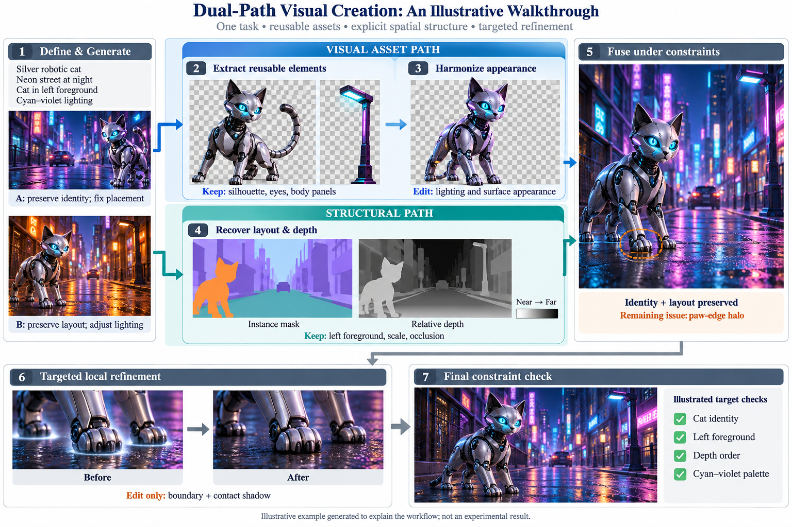

## A Structured Multi-Stage Workflow for Controllable AI-Assisted Visual Creation

### Abstract

AI-generated concept images often present challenges for targeted refinement, particularly when multiple requirements regarding object identity, spatial relationships, and visual consistency must be satisfied simultaneously. Whole-image regeneration frequently corrects one requirement while introducing unintended disruptions to others.

This thesis proposes a dual-path workflow that enables selective reuse and structured refinement of concept imagery. The visual pathway extracts reusable visual elements from candidate sketches, while the structural pathway encodes object layout and relative depth information. These two representations are integrated via a fusion stage that explicitly distinguishes invariant properties from permitted appearance modifications. We present a complete evaluation framework spanning initial prompting strategies, element extraction, structural conditioning, fusion quality, and end-to-end joint constraint satisfaction under fixed model-call budgets.

We evaluate the proposed workflow across both controlled benchmark scenes and real-world concept sketch scenarios. Empirical results demonstrate key trade-offs between extraction region coverage and source fidelity, the complementary control roles of mask and depth conditioning, and the capacity of combined visual and spatial inputs to improve overall constraint compliance. Results also identify upstream extraction quality and automated evaluator reliability as critical performance-limiting factors. We further show that joint constraint satisfaction provides a stricter and more practically relevant measure of task success than average requirement scores alone.

The primary contributions of this work are the proposed workflow design and a systematic evaluation framework for studying controllable concept image refinement. Experimental findings validate the core design logic of the dual-path architecture and provide actionable insights for pipeline optimization. Full end-to-end validation on larger-scale datasets and user studies with intended creative practitioners remain important directions for future investigation.

### Hardware Configuration

Experiments were conducted across three computing environments.

| Component | Instance 1 | Instance 2  | Instance 3 |
| ---- | ---- | ---- | ---- |
| CPU / vCPU | Intel Core i9-13900K (24C/32T) | 16 vCPU | Intel Core i7-13700H (14C/20T) |
| GPU | NVIDIA RTX 4090, 24 GB | NVIDIA L40S, 48 GB | NVIDIA RTX 4060 Laptop, 8 GB |
| GPU Memory | 24 GB GDDR6X | 48 GB GDDR6 (ECC) | 8 GB GDDR6 |
| System Memory | 64 GB DDR5 | 64 GB DDR5 | 32 GB DDR4 |

### Text-Guided Initial Concept Image Generation

This experiment examines how prompt organization and requirement order affect the generation of concept images under multiple constraints.

The benchmark contains 60 tasks distributed evenly across six categories: characters, landscapes, architecture and interiors, products and still life, animals, and multi-subject scenes. Each task contains four levels of requirements: L0 defines the core subject and scene; L1 specifies style and atmosphere; L2 describes composition and framing; and L3 covers lighting, materials, and details.

Four prompt variants are constructed for each task using the identical set of requirements, to isolate the effects of formulation, grouping, and ordering:

| Condition          | Description                                                                 |
| ------------------ | --------------------------------------------------------------------------- |
| FF — Narrative     | Requirements presented as continuous prose                                  |
| FL — Flat list     | The hierarchical prompt's clauses and order retained, with level labels and grouping removed |
| H — Hierarchical   | Requirements explicitly grouped in L0 → L1 → L2 → L3 order                  |
| OA — Order ablation| The same labeled groups presented in reverse order                          |

Additional leave-one-out ablations (H⁻¹, H⁻², H⁻³) are conducted by individually removing Level 1, Level 2, or Level 3 from the hierarchical prompt while preserving all remaining content.

For progressive requirement analysis, cumulative prompt sets C0 (L0 only), C1 (L0–L1), C2 (L0–L2) are also constructed.

The complete set of task prompts is stored in:
[Text-Guided Initial Concept Image Generation/exact_prompts_600.jsonl](Text-Guided%20Initial%20Concept%20Image%20Generation/exact_prompts_600.jsonl)

To ensure robustness across model architectures, the protocol is executed on two open-source and two closed-source text-to-image models. For open-source models, the sampler configuration, number of denoising steps, guidance scale, and resolution are fixed per model at developer-recommended defaults. A shared set of 8 fixed random seeds is applied across all experimental conditions for open-weight models, forming a fully paired comparison design. Closed API models do not support seed specification; for these models, 4 samples are generated per condition, and samples are treated as exchangeable independent observations.

| Label | Model | Sampler / Scheduler | Inference Steps | Guidance Scale | Output Resolution | Access | 
|-------|-------|---------------------|-----------------|----------------|-------------------| ------ | 
| Open-A | SD3.5 Large | Checkpoint-provided default scheduler | 28 | 4.5 | 1024 × 1024 | [Open weights](https://huggingface.co/stabilityai/stable-diffusion-3.5-large) |
| Open-B | FLUX.2-dev | Checkpoint-provided default scheduler | 50 | 4.0 | 1024 × 1024 | [Open weights](https://huggingface.co/black-forest-labs/FLUX.2-dev) |
| Closed-A | Gemini 3.1 Flash Image | Provider-managed | Not exposed | Not exposed | 1K, 1:1 | [Closed API](https://ai.google.dev/gemini-api) |
| Closed-B | Seedream 4.5 | Provider-managed | Not exposed | Not exposed | 2048 × 2048 | [Closed API](https://www.doubao.com/) |

For each task, a set of distinct questions is designed to compute VQAScore via VLM. The complete question list is available at:
[benchmark_60_tasks.json](Text-Guided%20Initial%20Concept%20Image%20Generation/benchmark_60_tasks_complete.json)

VQAScore is computed via CLIP-FlanT5-XXL ([CLIP-FlanT5-XXl](https://huggingface.co/zhiqiulin/clip-flant5-xxl)), which outputs the likelihood of the specified target answer. 

The level-wise score is computed via ([Level_score](Text-Guided%20Initial%20Concept%20Image%20Generation/level_score.py)). The level-wise score results are recorded in ([Generation_scores](Text-Guided%20Initial%20Concept%20Image%20Generation/generation_scores.jsonl)). 

The cross-level retention is computed via ([Cross_level](Text-Guided%20Initial%20Concept%20Image%20Generation/cross_level.py)). The cross-level retention results are recorded in ([Constraint_trajectories](Text-Guided%20Initial%20Concept%20Image%20Generation/constraint_trajectories.jsonl)). 

To examine the stability of image generation, we use ([DreamSim](https://github.com/ssundaram21/dreamsim)) to measure visual similarity across repeated samples ([Similarity](Text-Guided%20Initial%20Concept%20Image%20Generation/similarity.py)). We also extract segmentation masks for the main subject from [benchmark_60_tasks.json](Text-Guided%20Initial%20Concept%20Image%20Generation/benchmark_60_tasks_complete.json) via Grounding DINO + SAM 2 [Grounded SAM 2](https://github.com/IDEA-Research/Grounded-SAM-2/tree/main), and calculate pairwise IoU among generated images [IoU](Text-Guided%20Initial%20Concept%20Image%20Generation/IoU.py). These results are stored in the ([auxiliary](Text-Guided%20Initial%20Concept%20Image%20Generation/auxiliary_proxies.jsonl)). A 20-task subset is additionally sampled, then paraphrase the prompts and apply the same VQA scoring procedure to further assess robustness ([Paraphrase_20_tasks](Text-Guided%20Initial%20Concept%20Image%20Generation/paraphrase_20_tasks.json)) ([Paraphrase_scores](Text-Guided%20Initial%20Concept%20Image%20Generation/paraphrase_scores.jsonl)).

To evaluate the general aesthetic quality of generated images, we use [Q-Align and MUSIQ](https://github.com/chaofengc/IQA-PyTorch) ([Quality_test](Text-Guided%20Initial%20Concept%20Image%20Generation/quality.py)). The scores are stored in ([auxiliary](Text-Guided%20Initial%20Concept%20Image%20Generation/auxiliary_proxies.jsonl)).

After statistical processing of the above metrics, the statistical plots below are obtained ([Statistic](Text-Guided%20Initial%20Concept%20Image%20Generation/statistic.py)).

### Reusable Visual Element Extraction

This experiment examines how different extraction approaches isolate visual elements while preserving their appearance for subsequent reuse. Evaluation covers a controlled benchmark with ground truth (Tier 1) and concept images from the creative workflow (Tier 2). Each tier contains 120 extraction tasks. Tasks cover compact single objects, luminous multi-instance structures, and thin line-like silhouettes. Tier 1 contains 40 tasks per category. Each tool–task pair has five runs. Generation prompts are available in [reusable_visual_element_extraction_prompts.json](Reusable%20Visual%20Element%20Extraction/reusable_visual_element_extraction_prompts.json).

Four tools are evaluated on Tier 1 and three on Tier 2.

Tier | Test images | Tools |
|---|---|---|
| T1 — Controlled benchmark | Composited foreground layers and backgrounds with known target alpha | SAM 2 with oracle boxes; Grounded SAM 2; Gemini; Seedream |
| T2 — Workflow images | Concept sketches with specified extraction targets, without ground-truth masks | Grounded SAM 2; Gemini; Seedream

Tool | Input and role | Reference |
|---|---|---|
| SAM 2 (oracle) | A box derived from the target's ground-truth visible mask; Tier 1 diagnostic reference | [SAM 2](https://github.com/facebookresearch/sam2) |
| Grounded SAM 2 | Textual target localization followed by box-prompted segmentation | [Grounded SAM 2](https://github.com/IDEA-Research/Grounded-SAM-2), [Grounding DINO](https://github.com/IDEA-Research/GroundingDINO) |
| Gemini 3.1 Flash Image | Image-conditioned generative extraction | [Closed API](https://ai.google.dev/gemini-api) |
| Seedream 4.5 | Image-conditioned generative extraction |  [Closed API](https://www.doubao.com/) |

Tier 1 foreground layers are generated using [LayerDiffuse](https://github.com/lllyasviel/LayerDiffuse), retaining their native alpha mattes ([image_input](Reusable%20Visual%20Element%20Extraction/image_input.py)). 

Perceptual comparisons use [LPIPS](https://github.com/richzhang/PerceptualSimilarity). Boundary evaluation follows [Boundary IoU](https://github.com/bowenc0221/boundary-iou-api). Feature and identity evaluation use [DINOv2](https://github.com/facebookresearch/dinov2) and [SigLIP](https://github.com/google-research/big_vision). 

| Tier | Metric | Code |
|---|---|---|
| T1 | IoU | [extraction_metrics/iou.py](Reusable%20Visual%20Element%20Extraction/iou.py) |
| T1 | Boundary IoU | [extraction_metrics/boundary_iou.py](Reusable%20Visual%20Element%20Extraction/boundary_iou.py) |
| T1 | Masked LPIPS | [extraction_metrics/masked_lpips.py](Reusable%20Visual%20Element%20Extraction/masked_lpips.py) |
| T1 | Swap error | [extraction_metrics/swap_error.py](Reusable%20Visual%20Element%20Extraction/swap_error.py) |
| T1 | Usable rate | [extraction_metrics/usable_rate.py](Reusable%20Visual%20Element%20Extraction/usable_rate.py) |
| T2 | Masked LPIPS | [extraction_metrics/masked_lpips.py](Reusable%20Visual%20Element%20Extraction/masked_lpips.py) |
| T2 | DINO similarity | [extraction_metrics/dino_similarity.py](Reusable%20Visual%20Element%20Extraction/dino_similarity.py) |
| T2 | Boundary-edge agreement | [extraction_metrics/edge_agreement.py](Reusable%20Visual%20Element%20Extraction/edge_agreement.py) |
| T2 | Target identity accuracy | [extraction_metrics/identity_accuracy.py](Reusable%20Visual%20Element%20Extraction/identity_accuracy.py) |

The complete run records are stored in [Run_data](Reusable%20Visual%20Element%20Extraction/run_data.json).

The statistical analysis results are stored in [Summary](Reusable%20Visual%20Element%20Extraction/summary.json) [Statistics](Reusable%20Visual%20Element%20Extraction/statistics.json), via [code](Reusable%20Visual%20Element%20Extraction/statistics.py)

T1 tool | IoU ↑ | B-IoU ↑ | LPIPS ↓ | Swap ↓ | Usable (%) ↑ |
|---|---|---|---|---|---|
| SAM 2 (oracle) | .883 (.871–.896) | .812 | .026 | .085 | 38.5 (29.8–47.2) |
| Grounded SAM 2 | .822 (.806–.839) | .750 | .031 | .117 | 27.5 (19.8–35.7) |
| Gemini | .833 (.817–.849) | .762 | .090 | .150 | 23.8 (18.3–29.5) |
| Seedream | .812 (.795–.829) | .742 | .104 | .170 | 14.5 (10.2–19.0) |

| T2 tool | LPIPS ↓ | DINO ↑ | Edge ↑ | Identity (%) ↑ |
|---|---|---|---|---|
| Grounded SAM 2 | .031 | .929 | .716 | 96.0 |
| Gemini | .089 | .903 | .747 | 95.7 |
| Seedream | .108 | .889 | .707 | 94.2

### Spatial Structure Extraction and Conditioning

### Visual-Spatial Fusion and Compositional Refinement 
